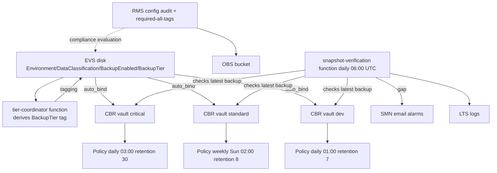

# deterministic-operations-ebs-snapshot-lifecycle

[](LICENSE)
[](https://www.huaweicloud.com)
[](https://www.terraform.io)
Tiered scheduled snapshots for EVS disks based on native Huawei Cloud services, plus tag compliance and snapshot integrity verification automation.
Differential backup retention policies for disks at different importance levels, with continuous verification of backup validity and enforced tag compliance.

## 1. Overview

### Introduction

This practice builds an automated solution based on native Huawei Cloud services: tiered scheduled snapshots for EVS disks, tag compliance, and snapshot integrity verification. Core value:

- **Tiered backup**: differential retention policies for disks at different importance levels based on the `BackupTier` tag.
- **Continuous verification**: scheduled scans of backup integrity, with automatic alarms for gaps.
- **Enforced compliance**: tag compliance enforced through RMS (Resource Governance Center) configuration audit.
- **Observability**: LTS logs plus SMN email alarms, with no blind spots for operations.

---

## 2. Table of Contents

- [1. Overview](#1-overview)
- [2. Table of Contents](#2-table-of-contents)
- [3. Architecture Diagram](#3-architecture-diagram)
- [4. Highlights](#4-highlights)
- [5. Cloud Services Used](#5-cloud-services-used)
- [6. Prerequisites](#6-prerequisites)
- [7. Quick Start](#7-quick-start)
- [8. Step-by-Step Deployment](#8-step-by-step-deployment)
- [9. Usage / Verification](#9-usage--verification)
- [10. Cleanup](#10-cleanup)
- [11. Detailed Explanation](#11-detailed-explanation)
- [12. Dependencies](#12-dependencies)
- [13. FAQ / Troubleshooting](#13-faq--troubleshooting)
- [14. Contributing](#14-contributing)
- [15. License](#15-license)
- [16. Contact / Maintainers](#16-contact--maintainers)


```
deterministic-operations-ebs-snapshot-lifecycle/
├── docs/ # practice documentation
│ ├── architecture.md # architecture description
│ ├── deployment-guide.md # deployment guide
├── infra/ # Terraform IaC (huaweicloud Provider)
│ ├── versions.tf
│ ├── variables.tf
│ ├── main.tf # EVS/CBR/OBS/RMS/SMN/IAM agency
│ ├── functions.tf # FunctionGraph function + TIMER trigger + LTS
│ └── terraform.tfvars
├── src/
│ └── functions/
│ ├── snapshot_verification/index.py # snapshot integrity verification
│ └── tier_coordinator/index.py # tier tag coordination
└── README.md
```

---

## 3. Architecture Diagram



See [docs/architecture.md](docs/architecture.md) for details.

---

## 4. Highlights

### Three-Tier Backup Policy

| Tier | Matching tags (AND) | Schedule (UTC) | Retention |
|------|--------------------|----------------|-----------|
| Critical | `Environment=prod` & `DataClassification=critical` & `BackupEnabled=true` | Daily 03:00 | 30 snapshots |
| Standard | `Environment=prod` & `DataClassification=standard` & `BackupEnabled=true` | Weekly Sun 02:00 | 8 snapshots |
| Dev | `Environment=dev` & `BackupEnabled=true` | Daily 01:00 | 7 snapshots |

---

## 5. Cloud Services Used

- EVS (Elastic Volume Service)
- CBR (Cloud Backup and Recovery)
- OBS (Object Storage Service)
- RMS (Resource Governance Center)
- SMN (Simple Message Notification)
- LTS (Log Tank Service)
- FunctionGraph

---

## 6. Prerequisites

- A Huawei Cloud account (identity verified, with sufficient balance)
- The target region supports CBR disk backup, FunctionGraph, and RMS (default `cn-north-4`)
- Terraform >= 1.5
- Huawei Cloud access keys AK/SK (obtained on the "My Credentials" page in Huawei Cloud and filled into the deployment script)

---

## 7. Quick Start

```bash
cd infra
export HW_ACCESS_KEY="<HW_ACCESS_KEY>"
export HW_SECRET_KEY="<HW_SECRET_KEY>"
terraform init
terraform validate
terraform plan
# After confirming everything is correct:
terraform apply
```

For the complete steps and cleanup, see [docs/deployment-guide.md](docs/deployment-guide.md).

---

## 8. Step-by-Step Deployment

1. Configure the variables in `infra/terraform.tfvars`.
2. Set the Huawei Cloud AK/SK environment variables.
3. Run `terraform init` to initialize the provider.
4. Run `terraform validate` to check the syntax.
5. Run `terraform plan` to preview the changes.
6. Run `terraform apply` to deploy.

---

## 9. Usage / Verification

### Usage and Verification

- **Tiered backup based on the `BackupTier` tag**: derive a single `BackupTier` tag and use the `tier-coordinator` function (scheduled hourly to update the tagging of the original three tags), so that CBR vaults use `bind_rules` to precisely associate disks of the corresponding tier.
- **Credential security**: function runtime credentials are provided through environment variables by the FunctionGraph agency; no real AK/SK/Token appears in code or documentation.

After deployment, follow these steps to verify that the business functionality works before considering the delivery complete.

---

## 10. Cleanup

```bash
cd infra && terraform destroy
```

> Before `destroy`, confirm that there are no backups you need to keep; an OBS bucket with `force_destroy=true` will be deleted along with its contents.

---

## 11. Detailed Explanation

- Architecture and components: `docs/architecture.md`
- Complete deployment steps: `docs/deployment-guide.md`

---

## 12. Dependencies

- Huawei Cloud Terraform Provider (`huaweicloud`)
- Native Huawei Cloud services: EVS / CBR / OBS / RMS / SMN / LTS / FunctionGraph

---

## 13. FAQ / Troubleshooting

### FAQ

- **The RMS agency `apply` fails with `invalid delegated service`**: change `rms_agency_delegated_service` to `rms`, or create an agency named `rms_tracker_agency` in the console and reference its name.
- **The function reports a missing SDK package at runtime**: import the corresponding dependency versions `huaweicloudsdkcbr` / `huaweicloudsdkevs` / `huaweicloudsdksmn` in FunctionGraph dependency management.
- **SMN email is not received**: check whether the subscription has been "confirmed" (click the link in the confirmation email).

---

## 14. Contributing

Issues and PRs are welcome. Please follow the existing directory structure and code style in the repository.

---

## 15. License

This practice is licensed under **MIT No Attribution**; see the [`LICENSE`](LICENSE) file in the repository root.

This project is released under the MIT-0 License. See [LICENSE](LICENSE).

---

## 16. Contact / Maintainers
| Item | Content |
|---|---|
| **Creator** | [dgc-git](https://github.com/dgc-git) |
| **Maintainer** | [dgc-git](https://github.com/dgc-git) |
| **Contact** | GitHub Issues / PR (see [Section 14](#14-contributing)) |
