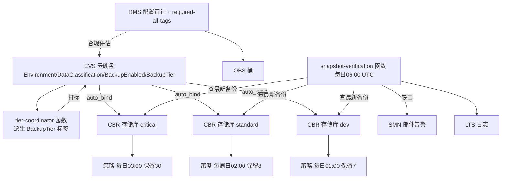

# deterministic-operations-ebs-snapshot-lifecycle · 云硬盘分层快照自动化最佳实践（华为云）

[](LICENSE)
[](https://www.huaweicloud.com)
[](https://www.terraform.io)
基于华为云原生服务的 EVS 云硬盘分层定时快照 + 标签合规 + 快照完整性校验自动化方案。
对不同重要级别的云硬盘施以差异化备份保留策略，并持续校验备份有效性、强制标签合规。

## 1. 简介 / Overview

### 简介


本实践基于华为云原生服务构建 EVS 云硬盘分层定时快照 + 标签合规 + 快照完整性校验的自动化方案。核心价值：

- **分层备份**：按 `BackupTier` 标签对不同重要级别的云硬盘施以差异化保留策略。
- **持续校验**：定时扫描备份完整性，缺失自动告警。
- **强制合规**：通过 RMS 配置审计强制标签合规。
- **可观测**：LTS 日志 + SMN 邮件告警，运维侧无盲区。

---

## 2. 目录

- [1. 简介 / Overview](#1-简介--overview)
- [2. 目录](#2-目录)
- [3. 架构图](#3-架构图)
- [4. 方案亮点](#4-方案亮点)
- [5. 涉及云服务](#5-涉及云服务)
- [6. 前置条件](#6-前置条件)
- [7. 快速开始](#7-快速开始)
- [8. 分步部署](#8-分步部署)
- [9. 使用方法 / 验证](#9-使用方法--验证)
- [10. 清理资源](#10-清理资源)
- [11. 详细说明](#11-详细说明)
- [12. 依赖](#12-依赖)
- [13. FAQ / 故障排除](#13-faq--故障排除)
- [14. 贡献指南](#14-贡献指南)
- [15. 许可证](#15-许可证)
- [16. 联系方式 / 维护者](#16-联系方式--维护者)


```
deterministic-operations-ebs-snapshot-lifecycle/
├── docs/ # 实践文档
│ ├── architecture.md # 架构说明
│ ├── deployment-guide.md # 部署指导书
├── infra/ # Terraform IaC（huaweicloud Provider）
│ ├── versions.tf
│ ├── variables.tf
│ ├── main.tf # EVS/CBR/OBS/RMS/SMN/IAM 委托
│ ├── functions.tf # FunctionGraph 函数 + TIMER 触发器 + LTS
│ └── terraform.tfvars
├── src/
│ └── functions/
│ ├── snapshot_verification/index.py # 快照完整性校验
│ └── tier_coordinator/index.py # 分层标签协调
└── README.md
```

---

## 3. 架构图



详见 [docs/architecture.md](docs/architecture.md)。

---

## 4. 方案亮点

### 三档备份策略

| 档位 | 命中标签（AND） | 执行时间(UTC) | 保留 |
|------|----------------|---------------|------|
| 关键 critical | `Environment=prod` & `DataClassification=critical` & `BackupEnabled=true` | 每日 03:00 | 30 份 |
| 标准 standard | `Environment=prod` & `DataClassification=standard` & `BackupEnabled=true` | 每周日 02:00 | 8 份 |
| 开发 dev | `Environment=dev` & `BackupEnabled=true` | 每日 01:00 | 7 份 |

---

## 5. 涉及云服务

- EVS（弹性云服务器）
- CBR（云备份）
- OBS（对象存储服务）
- RMS（资源治理中心）
- SMN（消息通知服务）
- LTS（日志服务）
- FunctionGraph（函数工作流）

---

## 6. 前置条件

- 华为云账号（已实名、余额充足）
- 目标区域支持 CBR 磁盘备份、FunctionGraph、RMS（默认 `cn-north-4`）
- Terraform ≥ 1.5
- 华为云访问密钥 AK/SK（在华为云「我的凭证」页面获取并填入部署脚本）

---

## 7. 快速开始

```bash
cd infra
export HW_ACCESS_KEY="<HW_ACCESS_KEY>"
export HW_SECRET_KEY="<HW_SECRET_KEY>"
terraform init
terraform validate
terraform plan
# 确认无误后：
terraform apply
```

完整步骤与清理见 [docs/deployment-guide.md](docs/deployment-guide.md)。

---

## 8. 分步部署

1. 配置 `infra/terraform.tfvars` 变量。
2. 设置华为云 AK/SK 环境变量。
3. 执行 `terraform init` 初始化 provider。
4. 执行 `terraform validate` 语法校验。
5. 执行 `terraform plan` 预览。
6. 执行 `terraform apply` 部署。

---

## 9. 使用方法 / 验证

### 使用方法与验证


- **基于 BackupTier 标签的分层备份**：通过派生单一 `BackupTier` 标签 +
`tier-coordinator` 协调函数（按小时调度更新原始三标签打标），让 CBR 存储库按
`bind_rules` 精确关联对应层级的云硬盘。
- **凭证安全**：函数运行期凭证由 FunctionGraph 委托注入环境变量，代码与文档中
不出现任何真实 AK/SK/Token。

部署完成后请按本节步骤自行验证，确认业务功能可用，方可视为交付完成。

---

## 10. 清理资源

```bash
cd infra && terraform destroy
```

> `destroy` 前请确认已无需要保留的备份；OBS 桶设了 `force_destroy=true` 会一并删除。

---

## 11. 详细说明

- 架构与组件：`docs/architecture.md`
- 完整部署步骤：`docs/deployment-guide.md`

---

## 12. 依赖

- 华为云 Terraform Provider (`huaweicloud`)
- 华为云原生服务：EVS/CBR/OBS/RMS/SMN/LTS/FunctionGraph

---

## 13. FAQ / 故障排除

### FAQ

- **RMS 委托 apply 报 `invalid delegated service`**：将 `rms_agency_delegated_service` 改为 `rms`，或在控制台创建名为 `rms_tracker_agency` 的委托后引用其名称。
- **函数运行报缺 SDK 包**：在 FunctionGraph 依赖管理中引入 `huaweicloudsdkcbr` / `huaweicloudsdkevs` / `huaweicloudsdksmn` 对应依赖版本。
- **SMN 收不到邮件**：检查订阅是否已"确认订阅"（点击确认邮件）。

---

## 14. 贡献指南

欢迎提交 Issue 与 PR。请遵循仓库内现有目录结构与代码风格。

---

## 15. 许可证

本实践采用 **MIT No Attribution** 许可证，详见仓库根目录 [`LICENSE`](LICENSE) 文件。

本项目以 MIT-0 许可证发布。详见 [LICENSE](LICENSE)。

---

## 16. 联系方式 / 维护者
| 项 | 内容 |
|---|---|
| **创建者** | [dgc-git](https://github.com/dgc-git) |
| **维护者** | [dgc-git](https://github.com/dgc-git) |
| **联系方式** | GitHub Issues / PR（见[第 14 节](#14-贡献指南)） |
