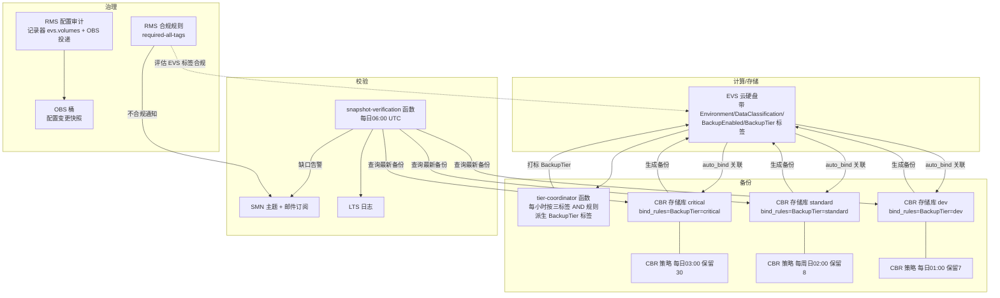

# 云硬盘分层快照自动化最佳实践（华为云）

本实践基于华为云原生服务，构建一套**云硬盘（EVS）分层定时快照 + 标签合规 + 快照完整性校验**
的自动化体系。适用于需要对不同重要级别云硬盘施以差异化备份保留策略、并持续校验备份有效性的场景。

## 1. 架构总览



## 2. 核心组件

| 组件 | 华为云服务 | 职责 |
|------|------------|------|
| 云硬盘 | EVS | 承载业务数据；以标签声明备份档位与合规属性 |
| 分层协调 | FunctionGraph（`tier-coordinator`） | 按原始三标签 AND 规则派生 `BackupTier` 标签 |
| 备份目标 | CBR 磁盘存储库 ×3 | 按 `bind_rules=BackupTier=<tier>` 自动关联云硬盘 |
| 备份策略 | CBR 备份策略 ×3 | 差异化的执行时间与保留份数 |
| 标签合规 | 配置审计 RMS | 强制 EVS 必须含 `Environment/DataClassification/BackupEnabled` |
| 变更留存 | OBS | 接收 RMS 资源变更快照与通知 |
| 快照校验 | FunctionGraph（`snapshot-verification`） | 每日核对最新备份新鲜度，缺口告警 |
| 告警 | SMN | 邮件通知校验缺口与合规不达标 |
| 日志 | LTS | 函数运行日志 |

## 3. 三档备份策略

| 档位 | 命中标签（AND） | 执行时间(UTC) | 保留 |
|------|----------------|---------------|------|
| 关键 critical | `Environment=prod` & `DataClassification=critical` & `BackupEnabled=true` | 每日 03:00 | 30 份 |
| 标准 standard | `Environment=prod` & `DataClassification=standard` & `BackupEnabled=true` | 每周日 02:00 | 8 份 |
| 开发 dev | `Environment=dev` & `BackupEnabled=true` | 每日 01:00 | 7 份 |

> `BackupTier` 标签由协调函数派生，是 CBR 存储库精确关联的唯一依据，规避了多标签 OR 的串档问题。

## 4. 数据流转
1. 新建/变更 EVS 云硬盘 → 协调函数每小时扫描，按标签规则打 `BackupTier`。
2. CBR 存储库 `auto_bind` 按 `bind_rules` 自动关联对应档位的云硬盘。
3. CBR 备份策略按时执行快照，存入存储库。
4. 校验函数每日核对每个 `BackupEnabled=true` 云硬盘的最新备份年龄（critical ≤2 天，其余 ≤8 天），缺口经 SMN 告警。
5. RMS 持续审计 EVS 标签合规，不合规项经 SMN 通知。

## 5. 目录结构

```
huaweicloud/deterministic-operations-ebs-snapshot-lifecycle/
├── docs/ # 本实践文档
├── infra/ # Terraform IaC
├── src/ # FunctionGraph 函数代码
└── README.md
```
